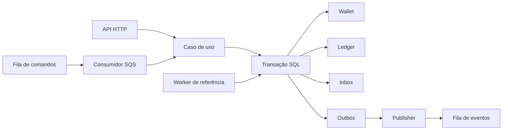

# Distributed Wagering Processor

Jungle Gaming — Backend Technical Challenge

Processador de apostas que recebe o mesmo comando por HTTP ou por fila, aplica o efeito financeiro uma vez e mantém o ledger conferível depois de duplicata, concorrência e queda de processo.

O enunciado original está em [docs/CHALLENGE.md](docs/CHALLENGE.md). As decisões fechadas estão em [ARCHITECTURE.md](ARCHITECTURE.md). O passo a passo de operação está em [SOLUTION.md](SOLUTION.md).

## Sumário

- [Visão geral](#visão-geral)
- [Stack tecnológica](#stack-tecnológica)
- [Arquitetura](#arquitetura)
- [Garantias implementadas](#garantias-implementadas)
- [Como executar](#como-executar)
- [Testes](#testes)
- [Concorrência](#concorrência)
- [Decisões arquiteturais](#decisões-arquiteturais)
- [Limitações conhecidas](#limitações-conhecidas)
- [Documentação adicional](#documentação-adicional)

## Visão geral

Provedores de jogo entregam apostas mais de uma vez, fora de ordem e para várias instâncias ao mesmo tempo. O saldo não pode negativar, o mesmo comando não pode debitar duas vezes e um evento de domínio não pode sair antes do commit.

A solução é um serviço NestJS no host, com PostgreSQL como fonte da verdade. A API e o consumidor SQS chamam o mesmo caso de uso. Uma transação SQL grava a wallet, o ledger, a inbox e a outbox. O reconhecimento da mensagem e a publicação do evento acontecem só depois desse commit.

## Stack tecnológica

A implementação foi exercitada com Bun 1.4.4, NestJS 11, TypeScript 5, MikroORM 6, PostgreSQL 16.10 e LocalStack 4.7.0. O avaliador precisa de Bun 1.x no `PATH` e de Docker Compose. Não há caminho de máquina no repositório.

| Peça | Uso |
| --- | --- |
| Bun | Runtime, testes e scripts |
| TypeScript | Código em modo strict |
| NestJS | API HTTP e composição do worker |
| PostgreSQL | Wallet, ledger, inbox, outbox e constraints |
| MikroORM | Transações e migrations reversíveis |
| AWS SQS | Filas FIFO de comando e de evento |
| LocalStack | SQS local, sem conta AWS |
| Docker Compose | Postgres e LocalStack |

Dinheiro não usa `number`. O valor circula como string e persiste em `numeric(20,2)`, com `decimal.js` na conta.

## Arquitetura

A API não sobe os workers. O worker não escuta HTTP. Os dois processos usam o mesmo banco e as mesmas filas.



A fila de comandos é `wager-transactions.fifo`. A de eventos é `wager-domain-events.fifo`. Payload inválido vai para `wager-transactions-dlq.fifo` na primeira leitura. O `MessageGroupId` do evento é a wallet. O `MessageDeduplicationId` é o `eventId`. A deduplicação de cinco minutos do FIFO não é a garantia de negócio.

## Garantias implementadas

- **Precisão financeira.** Amount entra e sai como string. A escala curta é preenchida até duas casas. Número JSON, código de moeda fora do formato permitido e zero externo são rejeitados antes de existir efeito.
- **Ledger imutável.** Cada transação financeira gera no máximo um lançamento. Um trigger recusa `UPDATE` e `DELETE` nessa tabela.
- **Idempotência persistente.** A chave `providerId:externalTransactionId` e o par provedor/transação externa são `UNIQUE`. O replay devolve o saldo observado na primeira vez, não o saldo vivo.
- **Concorrência por wallet.** O lock é `SELECT … FOR UPDATE` da linha da wallet. Outra wallet segue em paralelo. Não há lock da tabela.
- **Transactional Inbox e Outbox.** No caminho SQS, inbox, saldo, ledger e outbox commitam juntos. O HTTP não grava inbox.
- **Processamento at-least-once.** O `DeleteMessage` só ocorre depois do commit. Uma queda entre o commit e o ack não gera um segundo débito.
- **Recuperação após falhas.** A outbox permanece depois do commit. O publisher envia e só então grava `published_at`. Vários publishers usam `FOR UPDATE SKIP LOCKED` e, dentro da wallet, só o evento mais antigo ainda não publicado sai.
- **Referência fora de ordem.** `REFUND` ou `ROLLBACK` que chega antes da aposta fica `PENDING_REFERENCE`. Um worker resolve a espera com backoff. O prazo operacional é 15 minutos. No máximo uma reversão `PROCESSED` ocupa a referência, seja qual for o tipo.

## Como executar

```bash
cp .env.example .env
bun install
docker compose up -d --wait
bun run migration:up
bun run queues:up
```

A API e o worker são processos de longa duração. Cada um ocupa o terminal em que foi iniciado, então sobem em terminais separados.

```bash
bun run start
```

```bash
bun run worker
```

`bun run start` escuta a API na porta `PORT` do `.env`. O exemplo usa 3000. `bun run worker` sobe o consumidor, o publisher e o worker de referência.

O Compose publica o Postgres em `POSTGRES_HOST_PORT`. O exemplo usa 5432. Se essa porta estiver ocupada, troque a porta e as duas URLs do banco juntas. O LocalStack permanece em 4566. As credenciais do exemplo são as do Compose local e estão em `.env.example`. O arquivo `.env` não entra no Git.

Exemplos de abertura de wallet, aposta HTTP e mensagem SQS estão em [SOLUTION.md](SOLUTION.md).

## Testes

```bash
bun test
bun run test:distributed
bun run lint
bun run build
```

`bun test` cobre unidade, schema, HTTP e a integração assíncrona em um processo. `bun run test:distributed` sobe três ou mais processos Bun, com PIDs distintos, contra o mesmo PostgreSQL e o mesmo LocalStack.

As duas suítes truncam as tabelas financeiras deste banco. A suíte principal também desfaz e reaplica as migrations. A distribuída escuta nas portas 3471, 3472 e 3473 e reinicia os containers `postgres` e `localstack` deste Compose. Ela não apaga volume e não mexe em outros projetos.

Última execução validada, anterior a este documento. Esses números não foram reexecutados nesta revisão.

| Suíte | Resultado |
| --- | --- |
| Principal | 80 aprovados |
| Distribuída | 16 aprovados |
| Total | 96 aprovados, 0 falhas |

## Concorrência

Uma wallet com `100.00` BRL recebe duas apostas simultâneas de `80.00` BRL. Uma termina `PROCESSED`. A outra termina `REJECTED` com `INSUFFICIENT_FUNDS`. O saldo fica `20.00` BRL e o ledger tem um único `DEBIT` de `80.00`.

O mesmo cenário está coberto na persistência, no HTTP e na suíte distribuída. Cinquenta envios iguais da mesma aposta também deixam um único débito.

## Decisões arquiteturais

**`SELECT … FOR UPDATE`.** Duas apostas na mesma wallet precisam ser serializadas, senão as duas leem `100.00` e as duas debitam `80.00`. O lock da linha resolve essa corrida sem impedir o movimento de outra wallet.

**Idempotência persistida.** Um cache em memória some com o processo e não é visto pelas outras instâncias. A constraint no PostgreSQL continua valendo depois do restart e entre processos.

**Transactional Outbox.** Publicar antes do commit pode anunciar um efeito que o banco desfez. Gravar o evento na mesma transação e publicar depois permite reenviar o mesmo `eventId` se o processo cair entre o commit e o `SendMessage`.

**Ledger append-only.** Corrigir o passado no lugar apaga a trilha que a reconciliação precisa comparar com o saldo materializado. Lançamento novo é a única forma de mudar o histórico. A reconciliação compara e sinaliza. Ela não corrige o saldo.

A lista completa, inclusive as dez leituras que divergem do texto literal do enunciado, está em [ARCHITECTURE.md](ARCHITECTURE.md).

## Limitações conhecidas

Nenhuma destas limitações foi classificada como falha da correção financeira. O detalhe está em [ARCHITECTURE.md](ARCHITECTURE.md) e em [SOLUTION.md](SOLUTION.md).

- A autenticação real foi adiada de propósito. O enunciado deixa o mecanismo a cargo de quem implementa. O `AuthGuard` das rotas financeiras é no-op. Health continua aberto.
- Não há Identity Provider, dashboard, OpenTelemetry nem teste de carga.
- `57P03`, emitido quando o PostgreSQL está em shutdown, não entra na lista de erros transitórios. O worker conectado pode morrer. Um processo iniciado depois não duplica o débito já commitado.
- `ingress_rejects` pode repetir uma linha de auditoria. Essa linha não move saldo.
- `attempt_count` pode ser regravado se o lease da referência pendente vencer durante a resolução. O teste desse caso não produziu um segundo crédito.
- O consumidor que persiste `eventId` existe na suíte distribuída. O processo `bun run worker` não consome a fila de eventos. A janela do FIFO não substitui essa deduplicação.
- O LocalStack deste Compose não tem volume. Um restart perde mensagem já aceita pelo SQS. A outbox no PostgreSQL permanece.
- As métricas ficam na memória do processo. Não há endpoint de exportação.

## Documentação adicional

- [SOLUTION.md](SOLUTION.md) — ambiente, HTTP, SQS, concorrência e trade-offs
- [ARCHITECTURE.md](ARCHITECTURE.md) — decisões, modelo, falhas e divergências
- [docs/conformidade.md](docs/conformidade.md) — requisito, teste e risco residual
- [docs/setup.md](docs/setup.md) — versões e comandos de subida
- [docs/CHALLENGE.md](docs/CHALLENGE.md) — enunciado original da Jungle Gaming
